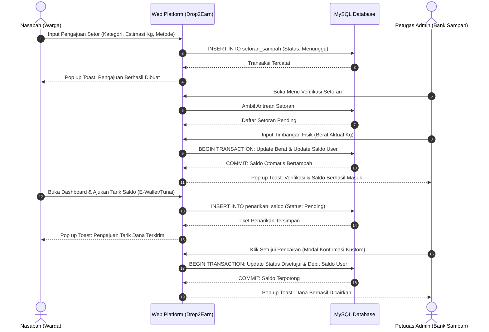
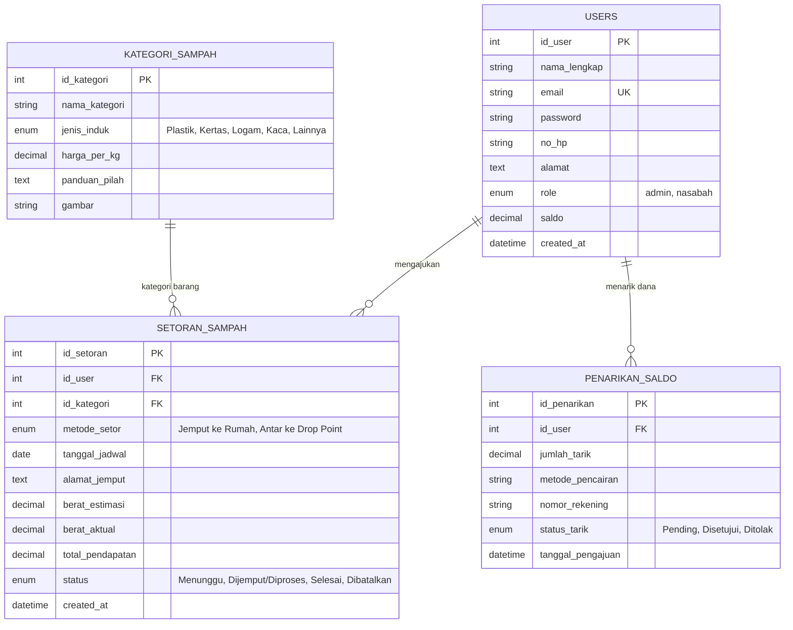

# LAPORAN BEDAH KASUS & IMPLEMENTASI SISTEM MINIMUM VIABLE PRODUCT (MVP)
## Ujian Mata Kuliah: Pemasaran & Bisnis Digital Praktik (IK 4517)
### Topik: Smart Waste Management (Digital Waste Bank & Pickup Directory)

---

| Informasi Akademik | Detail Pelaksanaan |
| :--- | :--- |
| **Mata Kuliah** | Pemasaran & Bisnis Digital Praktik (IK 4517) |
| **Topik Ujian** | Smart Waste Management / Bank Sampah Digital |
| **Nama Platform** | **Drop2Earn** ("Pilah dari Rumah, Ubah Sampah Jadi Berkah") |
| **Pendekatan Pengembangan** | Minimum Viable Product (MVP) |
| **Teknologi yang Digunakan** | PHP 8.1 Native, MySQL 8, Bootstrap 5.3, Vanilla JavaScript |
| **Gaya Desain Antarmuka** | Modern Flat 2.0 (Semi-Flat) & Card-Based Minimalist UI |
| **URL Akses Lokal** | `http://localhost/Drop2Earn/` |

---

## DAFTAR ISI
1. [BAGIAN I: ANALISIS KASUS & PEMECAHAN MASALAH BISNIS DIGITAL](#bagian-i-analisis-kasus--pemecahan-masalah-bisnis-digital)
2. [BAGIAN II: USER STORIES & ALUR KERJA PENGGUNA](#bagian-ii-user-stories--alur-kerja-pengguna)
3. [BAGIAN III: STRUKTUR BASIS DATA & ARSITEKTUR DATA](#bagian-iii-struktur-basis-data--arsitektur-data)
4. [BAGIAN IV: ARSITEKTUR SISTEM & DESAIN MODERN FLAT 2.0](#bagian-iv-arsitektur-sistem--desain-modern-flat-20)
5. [BAGIAN V: PENGUJIAN & VALIDASI SISTEM (QUALITY ASSURANCE)](#bagian-v-pengujian--validasi-sistem-quality-assurance)
6. [BAGIAN VI: MATRIKS KESESUAIAN DENGAN INSTRUKSI UJIAN](#bagian-vi-matriks-kesesuaian-dengan-instruksi-ujian)

---

## BAGIAN I: ANALISIS KASUS & PEMECAHAN MASALAH BISNIS DIGITAL

### 1. Analisis Permasalahan di Lapangan (Menjawab Instruksi 1)
Berdasarkan identifikasi lapangan, terdapat 4 friksi struktural utama yang menghambat perputaran ekonomi sirkular sampah rumah tangga:
1. **Asimetri Informasi Harga & Nilai Ekonomi:** Masyarakat tidak mengetahui jenis sampah rumah tangga mana (plastik PET, kardus, kertas arsip, kaleng/besi) yang laku dijual dan berapa harga pasar wajar per kilogramnya.
2. **Keterbatasan Akses Penyaluran:** Warga kesulitan menemukan lokasi bank sampah atau pengepul terdekat yang bersedia menerima sampah terpilah dalam skala rumah tangga atau kos.
3. **Kurangnya Edukasi Pemilahan (3C: *Clean, Clear, Compact*):** Ketidaktahuan cara pemilahan menyebabkan sampah bernilai jual tercampur dengan sampah basah/organik sehingga mengalami pembusukan dan kehilangan nilai jual.
4. **Ketidakpastian Layanan Pengelolaan:** Tidak tersedianya jadwal penjemputan berkala atau posko penyetoran yang terkoordinasi di lingkungan perumahan warga dan area kampus.

### 2. Segmentasi Target Pengguna
- **Segmen Primer (Penghasil Sampah):**
  - **Mahasiswa & Anak Kos (Usia 18-24 tahun):** Rutin menghasilkan kardus belanja paket online dan botol plastik kemasan air mineral.
  - **Ibu Rumah Tangga (Usia 25-45 tahun):** Mengelola konsumsi rumah tangga harian (botol minyak, jeriken sabun, kardus peralatan dapur).
  - **Pelaku Usaha Mikro (Warung/Kafe):** Memerlukan saluran pembuangan limbah kardus dan botol minuman harian dalam kuantitas menengah.
- **Segmen Sekunder (Pengelola & Pengepul):**
  - Petugas Bank Sampah unit kelurahan/komunitas lokal yang membutuhkan pasokan sampah terpilah bersih secara konsisten untuk dijual kembali ke pabrik daur ulang.

### 3. Mengapa Membutuhkan Solusi Digital?
Pencatatan konvensional menggunakan buku tabungan kertas rawan rusak/hilang, rentan salah hitung manual saat menimbang, dan menyulitkan warga memeriksa akumulasi saldo. Melalui web berbasis responsif (Bootstrap 5.3), pengguna dapat langsung mengecek katalog harga terkini, menjadwalkan penjemputan, memantau buku tabungan digital (*E-Passbook*), dan mencairkan insentif secara transparan.

### 4. Perancangan Ide Bisnis Digital (Menjawab Instruksi 2, 3, & 4)
- **Nama Platform:** **Drop2Earn**
- **Tagline:** *"Pilah dari Rumah, Ubah Sampah Jadi Berkah"*
- **Konsep:** Direktori harga sampah terbuka, panduan edukasi pilah, serta manajemen tabungan penyetoran sampah daur ulang berbasis web responsif.
- **Model Bisnis (Monetisasi - Spread Fee Margin):**
  Pengelola mengambil margin laba kotor sebesar 10% hingga 15% dari selisih harga beli sampah dari warga ($H_{beli}$) dengan harga jual grosir ke industri daur ulang ($H_{jual}$):
  
  $$\text{Margin Keuntungan Bank Sampah} = (H_{jual} - H_{beli}) \times \text{Berat Aktual (kg)}$$
  
  $$\text{Estimasi Margin Operasional} \approx 15\% \times \text{Total Omzet Grosir}$$

- **Empat Fitur Utama Platform MVP:**
  1. *Katalog Harga Transparan & Kalkulator Simulasi:* Menampilkan 8 kategori sampah terverifikasi beserta tarif per kg dan kalkulator estimasi saldo real-time.
  2. *Formulir Request Setor / Jemput Sampah:* Pengajuan fleksibel dengan pilihan opsi penjemputan ke rumah atau antar mandiri ke titik posko drop point.
  3. *Buku Tabungan Digital & Pencairan Saldo (E-Passbook):* Dashboard warga untuk memantau berat total, riwayat setoran, saldo aktif, serta pengajuan tarik dana ke e-wallet / tunai.
  4. *Panel Pengelola & Validasi Penimbangan (Admin CMS):* Fitur bagi petugas untuk memvalidasi timbangan riil, mengalkulasi saldo otomatis secara atomik, menyetujui penarikan, dan mengelola pengguna.

### 5. Rancangan Kampanye Pemasaran Digital (Menjawab Instruksi 4)
- **Media Sosial Utama:** Instagram (Carousel edukasi & Reels pendek), TikTok, serta grup broadcast WhatsApp komunitas RT/RW dan lingkungan kampus.
- **Konsep Visual:** *Split-Screen Comparison* antara "Sudut Kos Penuh Tumpukan Kardus (Nilai Rp 0)" vs "Saldo E-Wallet Tambahan Jajan".
- **Halaman Showcase Interaktif:** Dapat diakses secara visual di web melalui menu `promosi.php`.
- **Naskah Copywriting Resmi:**
  > "Kardus paket menumpuk di pojok kos? Botol plastik bekas minum cuma bikin sempit ruangan? Jangan dibuang begitu saja! Sekarang kamu bisa cek harga jual sampahmu dan tukarkan jadi saldo uang tunai lewat Drop2Earn. Cukup pilah dari rumah, ajukan jemput lewat web, dan biarkan sampahmu menghasilkan cuan sambil menjaga kelestarian bumi. Yuk, daftar gratis di website Drop2Earn sekarang: Pilah Sampah, Panen Berkah! #Drop2Earn #SmartWasteManagement #UbahSampahJadiRupiah #BankSampahDigital"

---

## BAGIAN II: USER STORIES & ALUR KERJA PENGGUNA

### 1. Matriks User Stories & Kriteria Penerimaan
| ID | Aktor | User Story | Kriteria Penerimaan (Acceptance Criteria) |
| :--- | :--- | :--- | :--- |
| **US-01** | Pengunjung | Sebagai pengunjung publik, saya ingin melihat katalog harga sampah per kg dan panduan pilah di halaman utama tanpa harus login. | Halaman utama menampilkan daftar harga 8 kategori sampah, ikon visual, tips pilah 3C, dan lokasi drop point resmi. |
| **US-02** | Pengunjung | Sebagai calon nasabah, saya ingin mendaftarkan akun baru dengan nomor kontak dan alamat rumah saya. | Form registrasi meminta nama, email unik, password (dihash Bcrypt), no WhatsApp, dan alamat domisili. |
| **US-03** | Nasabah | Sebagai nasabah terdaftar, saya ingin mengajukan penjemputan sampah dari rumah dengan mengisi estimasi berat dan jenis sampah. | Sistem menyimpan tiket setoran dengan status `Menunggu` dan mencatat alamat jemput serta tanggal yang dipilih. |
| **US-04** | Nasabah | Sebagai nasabah, saya ingin memilih opsi antar mandiri ke lokasi Posko Drop Point terdekat. | Alamat penjemputan otomatis terisi lokasi posko terpilih dan tidak mewajibkan penjemputan ke rumah. |
| **US-05** | Nasabah | Sebagai nasabah, saya ingin melihat buku tabungan digital saya yang berisi riwayat setoran dan saldo terkumpul. | Dashboard nasabah menampilkan widget saldo riil, total kg terkumpul, tabel riwayat setoran, dan status verifikasi. |
| **US-06** | Nasabah | Sebagai nasabah, saya ingin mengajukan penarikan saldo tabungan saya ke nomor e-wallet atau diambil tunai. | Sistem memvalidasi saldo minimal Rp 10.000 dan menolak pengajuan jika jumlah tarik melebihi saldo aktif. |
| **US-07** | Admin | Sebagai petugas bank sampah, saya ingin memverifikasi berat aktual sampah yang diserahkan dan sistem menghitung saldo otomatis. | Admin mengisi berat riil (kg), sistem mengalikan dengan tarif per kg, status menjadi `Selesai`, dan saldo nasabah bertambah secara atomik. |
| **US-08** | Admin | Sebagai pengelola, saya ingin memproses dan menyetujui pengajuan penarikan saldo nasabah. | Admin menekan tombol setujui, sistem mendebit saldo nasabah secara permanen dan mencatat status `Disetujui`. |
| **US-09** | Admin | Sebagai pengelola, saya ingin menambah, mengubah tarif, atau menghapus kategori sampah pada katalog. | CRUD master data kategori sampah tersimpan di basis data dan langsung terefleksi di halaman katalog publik. |
| **US-10** | Admin | Sebagai pengelola, saya ingin mengelola data akun pengguna (edit profil, force reset password, hapus akun). | Admin dapat mengganti paksa password nasabah yang bermasalah dan menghapus akun dengan proteksi konfirmasi modal kustom. |

### 2. Diagram Alur Transaksi Penyetoran hingga Pencairan Saldo

---

## BAGIAN III: STRUKTUR BASIS DATA & ARSITEKTUR DATA

Sistem menggunakan basis data relasional **MySQL** bernama `db_drop2earn` dengan 4 entitas tabel yang terintegrasi secara normal:

### Rincian Skema DDL
1. **`users`:** Menyimpan kredensial login (password dienkripsi menggunakan algoritma `PASSWORD_BCRYPT`), profil kontak, peran hak akses (`admin` atau `nasabah`), serta saldo tabungan dengan tipe data presisi tinggi `DECIMAL(12,2)`.
2. **`kategori_sampah`:** Menyimpan 8 jenis sampah daur ulang beserta harga per kilogram, kategori induk, gambar SVG monoline, dan petunjuk teknis pemilahan 3C.
3. **`setoran_sampah`:** Menyimpan tiket transaksi penjemputan/penyetoran sampah yang menghubungkan `id_user` dan `id_kategori`, mencakup perbandingan berat estimasi nasabah vs berat aktual timbangan fisik petugas.
4. **`penarikan_saldo`:** Mencatat permohonan pencairan dana saldo tabungan nasabah, metode pencairan (DANA, GoPay, OVO, Bank Transfer, Tunai), dan status validasi persetujuan admin.

---

## BAGIAN IV: ARSITEKTUR SISTEM & DESAIN MODERN FLAT 2.0

### 1. Prinsip Gaya Desain Visual Antarmuka
Aplikasi dibangun mengikuti filosofi **Modern Flat Design (Flat 2.0 / Semi-Flat)** dipadukan dengan **Card-Based Minimalist UI** dan **Clean Startup Landing Page UI**:
- **Flat 2.0 (Semi-Flat Elevation):** Menghindari bayangan berat, menggunakan micro-elevation bertingkat halus (`--d2e-shadow-sm`, `--d2e-shadow-md`, `--d2e-shadow-hover`) untuk memberi kedalaman modular.
- **Card-Based Layout:** Seluruh blok data disusun di dalam kartu dengan sudut membulat lebar (*squircle* `border-radius: 18px`).
- **Nature-Modern Palette:** Kombinasi warna hijau hutan (*forest emerald* `#15803d`) dan aksen daun cerah (`#22c55e`) berlatar mint lembut (`#f8faf8`), dipadukan dengan lencana pastel (*mint*, *sky blue*, *amber*, *rose*).
- **Tipografi:** Menggunakan font modern **Plus Jakarta Sans** dengan hierarki tipografi tegas dan keterbacaan tinggi.
- **Standar Aksesibilitas:** Target sentuh minimal 44 piksel (*44px tap targets*) pada seluruh tombol dan kontrol input, serta kontras warna teks yang mematuhi standar WCAG AA.

### 2. Restrukturisasi Navigasi & Alur Pengguna (User-Centric UX)
- **Navigasi Dinamis Pasca-Login:**
  - Navbar publik secara otomatis beralih menjadi panel **Sidebar Responsif** di sisi kiri dan **Topbar** di bagian atas setelah pengguna login.
  - Menu publik (*Katalog Harga*, *Panduan Pilah*, *Lokasi Drop Point*) dibersihkan dari sidebar agar pengguna fokus pada operasional dashboard.
  - Tombol **"Halaman Depan"** disematkan di samping nama pengguna pada topbar untuk mempermudah pengecekan landing page publik.
  - Menu profil dropdown disederhanakan menjadi **Profil Saya** dan **Keluar (Logout)**.
- **Pembersihan Footer:**
  - Kolom *"Navigasi Utama"* pada footer publik dihapus sepenuhnya tanpa menggeser kolom *"Posko Layanan & Kontak"* yang tetap terkunci rapi di sisi kanan.
- **Animasi Show-up & Pop-up Mikro:**
  - Efek kemunculan bertahap (*staggered entrance*) pada kartu analitik dan tabel saat dimuat.
  - Transisi modal dialog berskala halus (`scale(0.92)` ke `scale(1)` dengan timing `cubic-bezier`).
  - Animasi pop-in menu dropdown dari kanan atas.
- **Sistem Dialog & Notifikasi Terpadu:**
  - *Universal Confirmation Modal (`#d2eConfirmModal`):* Menggantikan kotak dialog kaku browser `confirm()` untuk seluruh aksi krusial (Logout, Hapus Akun Pengguna, Force Reset Password, Setujui/Tolak Pencairan, Batalkan Setoran).
  - *Floating Toast Notification Stack (`#d2e-toast-container`):* Notifikasi melayang dengan bilah hitung mundur waktu (*countdown progress bar* 4,5 detik), fitur jeda saat diarahkan kursor (*pause on hover*), dan visual pastel sesuai konteks (berhasil, peringatan, galat, informasi).

---

## BAGIAN V: PENGUJIAN & VALIDASI SISTEM (QUALITY ASSURANCE)

Pengujian fungsional dilakukan menggunakan metode **Black-Box Testing** dan diotomatisasi melalui skrip pengujian [`tests/run_tests.php`](file:///c:/laragon/www/Drop2Earn/tests/run_tests.php). Seluruh skenario uji bisnis dinyatakan **100% LULUS (PASS)**:

| ID Uji | Modul yang Diuji | Skenario Pengujian | Hasil Aktual Sistem | Status |
| :--- | :--- | :--- | :--- | :---: |
| **TC-01** | Katalog Publik | Akses katalog harga publik tanpa sesi login. | Ditemukan 8 kategori sampah daur ulang aktif lengkap dengan harga dan tips pemilahan. | **PASS** |
| **TC-02** | Registrasi Akun | Registrasi pengguna baru dengan email dan kata sandi. | Akun tersimpan dengan hash Bcrypt, saldo awal Rp 0, dan hak akses nasabah. | **PASS** |
| **TC-03** | Proteksi Hak Akses (RBAC) | Nasabah mencoba mengakses endpoint direktori `/admin/`. | Sistem menolak akses dan mengarahkan kembali (*redirect*) ke dashboard nasabah. | **PASS** |
| **TC-04** | Pengajuan Setoran | Nasabah mengajukan tiket setor sampah kardus. | Tiket tersimpan dengan status `Menunggu`, pendapatan sementara tercatat Rp 0. | **PASS** |
| **TC-05** | Verifikasi & Saldo Otomatis | Admin memverifikasi timbangan fisik 8,0 kg kardus. | Status berubah menjadi `Selesai`, saldo nasabah bertambah otomatis Rp 17.600 secara atomik. | **PASS** |
| **TC-06** | Validasi Penarikan Berlebih | Nasabah mencoba menarik Rp 50.000 dengan saldo aktif Rp 17.600. | Transaksi ditolak dengan notifikasi validasi: "Saldo tidak mencukupi". | **PASS** |
| **TC-07** | Persetujuan Pencairan Dana | Admin menyetujui pengajuan tarik saldo Rp 15.000. | Status berubah `Disetujui`, saldo nasabah terdebit secara atomik menjadi sisa Rp 2.600. | **PASS** |

---

## BAGIAN VI: MATRIKS KESESUAIAN DENGAN INSTRUKSI UJIAN

| No. Instruksi Soal Ujian | Poin Penilaian Akademik | Bukti Implementasi pada Proyek Drop2Earn | Lokasi Berkas Sumber |
| :--- | :--- | :--- | :--- |
| **Instruksi 1** | Analisis Permasalahan & Target Pengguna | Pemetaan 4 friksi utama lapangan (asimetri harga, akses penyaluran, edukasi 3C, layanan tidak pasti) dan penentuan segmen mahasiswa kos, ibu rumah tangga, dan bank sampah. | `LAPORAN_AKADEMIK_IK4517.md` (Bagian I) & `index.php` |
| **Instruksi 2** | Perancangan Ide Bisnis & Monetisasi | Nama Drop2Earn, model bisnis selisih harga (*spread fee margin* 10%-15%), serta perancangan 4 fitur utama MVP. | `LAPORAN_AKADEMIK_IK4517.md` (Bagian I) & `README.md` |
| **Instruksi 3** | User Stories & Alur Kerja Transaksi | 10 User Stories lengkap dengan acceptance criteria, diagram sekuens transaksi penyetoran, dan diagram ERD basis data. | `LAPORAN_AKADEMIK_IK4517.md` (Bagian II & III) |
| **Instruksi 4** | Konten Promosi Digital & Copywriting | Perancangan konten media sosial (Instagram Reels/Carousel, TikTok, WA Group), mockup poster komparasi visual, storyboard 15 detik, dan teks copywriting resmi. | `promosi.php` & `index.php` (Section Promosi) |
| **Implementasi Teknis** | Aplikasi Web Fungsional | Full-stack web siap saji dengan PHP 8 Native, Bootstrap 5.3, MySQL, Flat 2.0 Card UI, Universal Confirmation Modal, dan Floating Toast System. | Direktori root `c:\laragon\www\Drop2Earn\` |
| **Pengujian Sistem** | Validasi & Penjaminan Mutu | Skrip automated test runner 7 skenario uji bisnis (TC-01 s/d TC-07) dengan tingkat kelulusan 100%. | `tests/run_tests.php` |

---

## KESIMPULAN

Aplikasi **Drop2Earn** telah dirancang dan diimplementasikan secara komprehensif untuk menjawab seluruh instruksi lembar ujian mata kuliah **Pemasaran & Bisnis Digital Praktik (IK 4517)**. Sistem tidak hanya siap dioperasikan secara teknis pada lingkungan web server lokal (Laragon), namun juga menyajikan model bisnis digital yang realistis, arsitektur data yang aman dan atomik, antarmuka Modern Flat 2.0 yang ramah pengguna, serta strategi pemasaran digital yang siap ditayangkan di media sosial.

